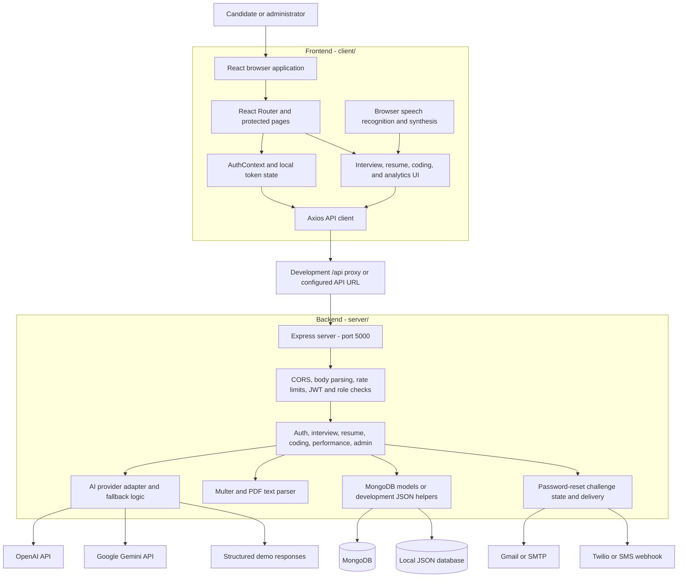
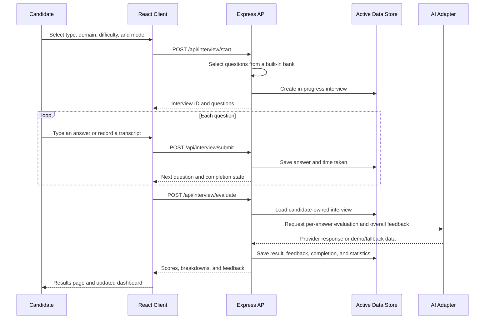
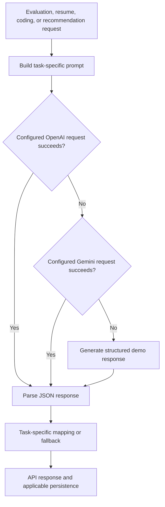
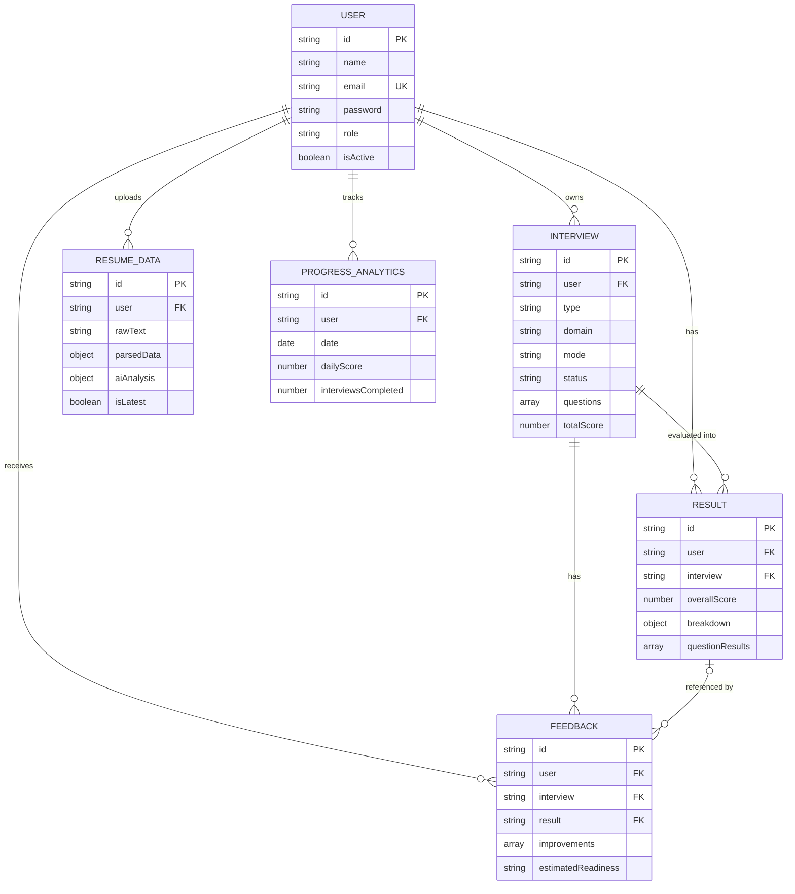

# InterviewAI - AI Interview Preparation Platform

**Practice interviews, review your resume, solve coding problems, and track your preparation in one application.**

InterviewAI is a full-stack interview preparation project built with React, Tailwind CSS, Node.js, and Express. It combines HR and technical question banks, text and voice practice, AI-assisted answer evaluation, PDF resume analysis, coding practice, progress dashboards, and administrator tools.

The application supports a persistent local JSON database for development and a MongoDB/Mongoose data path. It also includes demo responses when configured AI providers are unavailable.

**Project type:** Advanced MCA Final Year Project | **Domain:** AI / EdTech / Interview Preparation | **Year:** 2026

## Contents

- [Overview](#overview)
- [Features](#features)
- [Technology Stack](#technology-stack)
- [System Architecture](#system-architecture)
- [Application Workflows](#application-workflows)
- [AI Integration](#ai-integration)
- [Data Architecture](#data-architecture)
- [Resume Analysis Pipeline](#resume-analysis-pipeline)
- [Coding and Voice Practice](#coding-and-voice-practice)
- [Project Structure](#project-structure)
- [Installation and Setup](#installation-and-setup)
- [Running the Application](#running-the-application)
- [Environment Variables](#environment-variables)
- [API Reference](#api-reference)
- [Frontend Routes](#frontend-routes)
- [Password Recovery and OTP](#password-recovery-and-otp)
- [Administrator Access](#administrator-access)
- [Build and Deployment](#build-and-deployment)
- [Verification](#verification)
- [Troubleshooting](#troubleshooting)
- [Security and Data Handling](#security-and-data-handling)
- [Current Limitations](#current-limitations)
- [Future Enhancements](#future-enhancements)
- [Contributing](#contributing)
- [License](#license)

## Overview

Interview preparation often involves separate tools for questions, coding, resume feedback, and progress tracking. InterviewAI brings those activities into a shared account and dashboard.

| Area | Implementation |
|---|---|
| Frontend | React single-page application |
| Backend | Express REST API |
| Authentication | JWT bearer tokens and bcrypt password hashes |
| Development storage | Persistent JSON file under `server/data/` |
| Database integration | MongoDB through Mongoose |
| AI integration | OpenAI, Google Gemini fallback, and structured demo responses |
| Interview input | Typed answers or browser speech-recognition transcripts |
| Resume input | Text-based PDF, maximum 5 MB |
| Coding languages | JavaScript and Python editor modes |
| Default addresses | Frontend `http://localhost:3000`; backend `http://localhost:5000` |

### Current Account Flow

**Signup does not require OTP.** A user registers with a name, email, password, and optional phone number. The account is created immediately, and the user signs in separately.

OTP remains part of **forgot-password recovery** by registered email or phone number. Real delivery requires provider credentials; local development can display a development code.

## Features

### Mock Interviews

- HR, technical, and mixed interview configurations.
- Built-in question banks for Java, Python, web development, data science, cybersecurity, HR, DSA, and general preparation.
- Expanded behavioral/HR questions covering teamwork, feedback, leadership, motivation, conflict, and career goals.
- Configurable difficulty, question count, and text/voice mode.
- Per-question answer submission and elapsed-answer timing.
- Completed interview history and detailed result pages.

Questions are currently selected from server-side banks. Selecting a difficulty sets session metadata and evaluation context; it does not dynamically generate or independently calibrate the question bank.

### Answer Evaluation and Feedback

- Per-question scores and an overall score out of 100.
- Breakdowns for confidence, technical correctness, communication clarity, grammar, relevance, and problem solving.
- Feedback, sample answers, strengths, weaknesses, and suggested improvements.
- Overall readiness labels, recommended topics, and next steps.

The confidence and communication scores are derived from submitted text or speech transcripts. They are not measurements of facial expression, vocal tone, or other biometric signals.

### Resume Analyzer

- Upload a text-based PDF resume.
- Extract readable text and identify contact information and technical keywords.
- Review skills, strengths, weaknesses, missing keywords, target roles, and suggestions.
- Display an overall resume score and an ATS-style compatibility estimate.
- Keep the latest analysis available from the account.
- Fall back to local text analysis when the provider response is unavailable or unsuitable.

### Coding Practice

- Monaco editor with JavaScript and Python modes.
- Problem descriptions, examples, constraints, and starter code.
- Difficulty filters and topic-based problem API filtering.
- AI-assisted review of correctness, complexity, code quality, and possible improvements.
- Browser-side restrictions on copy, cut, paste, and related editor shortcuts during practice.

### Dashboards and Administration

- User statistics, recent results, score trends, and domain-level summaries.
- Recommendations and suggested learning priorities.
- Profile editing and password changes.
- Admin views for users, interviews, and aggregate analytics.
- Admin activation/deactivation and user deletion endpoints.

## Technology Stack

The table reflects the `client/package.json` and `server/package.json` manifests. Version ranges are declared dependency ranges, not a claim that every installation resolves to the same version.

| Layer | Technologies | Purpose |
|---|---|---|
| Frontend framework | React `^18.2.0`, React DOM `^18.2.0` | Component-based application and rendering |
| Routing | React Router DOM `^6.20.0` | Public, protected, and admin pages |
| Styling | Tailwind CSS `^3.3.5`, PostCSS, Autoprefixer | Styling and CSS processing |
| Animation | Framer Motion `^10.16.5` | Interface transitions |
| Icons and notifications | Lucide React `^0.294.0`, React Hot Toast `^2.4.1` | Icons and request feedback |
| HTTP client | Axios `^1.6.0` | API calls and authentication interceptors |
| Charts | Recharts `^2.10.1`; Chart.js and React Chart.js bindings are also declared | Performance visualizations |
| Code editor | `@monaco-editor/react ^4.6.0` | Coding-practice editor |
| File selection | React Dropzone `^14.2.3` | Resume-upload interactions |
| Browser speech | Web Speech APIs | Speech recognition and question playback |
| Frontend tooling | React Scripts `5.0.1` | Development server, build, and test command |
| Backend | Node.js, Express `^4.18.2` | REST API and request handling |
| Database models | Mongoose `^8.0.3` | MongoDB schemas and queries |
| Local storage | Node.js `fs`, JSON, in-memory indexes | Persistent development database |
| Authentication | JSON Web Token `^9.0.2`, bcryptjs `^2.4.3` | Token signing and password hashing |
| Validation | Express Validator `^7.0.1` | Auth-field validation |
| Request controls | CORS, Express Rate Limit `^7.1.5` | Allowed frontend origin and request limits |
| PDF uploads | Multer `^1.4.5-lts.1`, pdf-parse `^1.1.1` | Multipart upload and PDF text extraction |
| AI adapter | OpenAI SDK `^4.20.1`, Axios | Provider requests and fallback responses |
| Email | Nodemailer `^8.0.10` | Gmail or generic SMTP OTP delivery |
| SMS | Twilio Messages API or a configurable webhook | Phone OTP requests |
| Environment | dotenv `^16.3.1` | Root `.env` loading |
| Development orchestration | Concurrently `^8.2.0`, Nodemon `^3.0.2` | Run both services and reload the backend |

The root manifest includes additional packages and different version ranges. The active backend entry point uses the server subproject. A root dependency such as Socket.IO or Helmet does not mean that feature is configured in `server/server.js`.

`requirements.txt` contains reference notes only. This application runs with Node.js/npm; it does not require a Python web server or `pip install`.

## System Architecture



### Module Responsibilities

| Component | Responsibility |
|---|---|
| `client/src/pages/` | Feature screens and user interactions |
| `client/src/context/AuthContext.js` | Auth state, login, registration, logout, password recovery |
| `client/src/services/api.js` | Base API URL, bearer token attachment, error interception |
| `server/server.js` | Load settings, mount middleware/routes, start the API |
| `server/routes/*Routes.js` | Active endpoint definitions and access middleware |
| `server/controllers/` | Interview, resume, account, coding, and analytics workflows |
| `server/config/aiConfig.js` | Active AI provider selection and demo fallback |
| `server/config/devMemoryAuth.js` | Persistent local development data and indexes |
| `server/models/` | Mongoose schemas and model methods |
| `server/config/otpService.js` | OTP generation, hashing, and message delivery |

## Application Workflows

### Registration and Login

1. Submit name, email, password, and optional phone through `/register`.
2. The API validates fields, checks duplicate email, hashes the password, and creates the account.
3. Registration returns HTTP `201`; the frontend navigates to `/login`.
4. Login checks the password and returns a JWT plus public user data.
5. The frontend stores the token in `localStorage` and attaches it to protected requests.
6. The API checks token validity, user existence, activation state, and applicable role requirements.

Public registration creates the `user` role. There is no default administrator account supplied by the current signup flow.

### Interview Session



Unanswered questions receive zero in the question-result list. The overall score divides the accumulated score by the session's total question count. Results also map scores to grades from `A+` through `F`.

### Performance and Recommendations

The performance controller summarizes recent results, domain performance, weekly activity, and score dimensions. In MongoDB mode, recommendation prompts can include recent weak topics, domains, and average score. In local JSON mode, the current recommendation endpoint returns a predefined recommendation set.

## AI Integration

The controllers use `server/config/aiConfig.js` for external model requests.



| Task | AI Input | Expected Output |
|---|---|---|
| Interview evaluation | Question, answer, domain, difficulty | Scores, feedback, sample answer |
| Overall feedback | Session score and domain context | Strengths, weaknesses, next steps, readiness |
| Resume analysis | Extracted resume text | Skills, profile fields, resume/ATS-style feedback |
| Coding review | Problem, source code, language | Quality/correctness estimates, complexity, suggestions |
| Recommendations | Recent result context | Learning topics, practice questions, tips |

The adapter currently hardcodes `gpt-4-turbo-preview` and the Gemini `gemini-pro` endpoint. These are code configuration values, not a statement of current provider availability. Model access and endpoint compatibility must be checked for the provider account when configuring live AI use.

The repository also contains `server/config/aiService.js`, with a separate model configuration. The main feature controllers inspected here import `aiConfig.js`.

### Demo Behavior

Without usable provider responses, the shared adapter returns generic demo JSON, including randomized evaluation scores. This supports interface demonstrations but does not provide a reliable assessment of answer quality. Task controllers also have their own fallback handling; a generic mock response may not contain every task-specific field.

Resume analysis specifically checks and normalizes provider data against a local text-analysis result. No application-specific ML model is trained by this repository.

## Data Architecture

### Development JSON and MongoDB Modes

| Aspect | Local Development Mode | MongoDB Mode |
|---|---|---|
| Configuration | `NODE_ENV=development`, `USE_LOCAL_DB=true` | `USE_LOCAL_DB=false` and valid `MONGODB_URI` |
| Persistence | `server/data/local-db.json` by default | MongoDB collections |
| Helpers | `devMemoryAuth.js`, in-memory indexes, disk writes | Mongoose schemas and queries |
| IDs | UUID-based IDs with compatible `id`/`_id` fields | MongoDB ObjectIds |
| Recommendations | Predefined local recommendations | Recent result context plus provider request |
| Daily progress | JSON shape exists; not equivalent to every MongoDB update | ProgressAnalytics updates during evaluation |
| Intended use | Single-process development/demo | Database-backed application mode |

Despite its name, `devMemoryAuth.js` persists data to disk. Accounts and other stored records survive a normal restart if the same data file is retained.

Controllers select local helpers when the environment is not production and Mongoose is disconnected. Development can therefore fall back to local storage if a MongoDB connection fails. Local data is not automatically migrated into MongoDB when switching modes, so an account in one store may not exist in the other.

The JSON implementation rewrites the shared data file and is intended for a single development process. It is not a multi-worker database replacement. Production controllers do not use this development fallback.

### Logical Model Relationships



This is a logical relationship diagram. MongoDB stores documents and references rather than relational foreign-key constraints. Interview questions and their answers are embedded in interview documents.

## Resume Analysis Pipeline

1. Authenticate the upload request and accept the `resume` multipart field.
2. Check the PDF MIME type and enforce the middleware's **5 MB** limit.
3. Save a temporary file under `server/uploads/`.
4. Extract text with `pdf-parse`.
5. Send up to the first 3,000 extracted characters for provider analysis.
6. Normalize the returned fields and supplement them with local contact, skill, section, and keyword analysis.
7. Store parsed information, scores, suggestions, and up to 10,000 characters of extracted text.
8. Mark previous analyses as not latest and remove the temporary PDF after processing.

The local analyzer checks items such as education, projects, experience, measurable achievements, links, action verbs, and skill keywords. Scanned/image-only PDFs may produce little usable text because OCR is not implemented. The ATS-style score is an application estimate, not a certified score from a recruiting platform.

## Coding and Voice Practice

### Coding

The current backend bank contains six problems: Two Sum, Valid Parentheses, Reverse Linked List, Binary Search, Maximum Subarray, and Merge Intervals. Starter code is available for JavaScript and Python.

Code is sent to an AI review endpoint. There is no sandboxed execution service, compiler, or automated hidden-test judge in the current implementation. Complexity and correctness values are review output rather than measured execution results.

Clipboard restrictions are implemented through browser events, keyboard handling, and Monaco commands. They are practice controls, not a guarantee of cheating prevention.

### Voice

The voice screen uses `SpeechRecognition`/`webkitSpeechRecognition` for transcripts and `speechSynthesis` for reading questions. It is configured for `en-US` recognition. It submits the resulting text to the same interview answer/evaluation endpoints used by typed practice.

Voice mode requires browser support and microphone permission. Recognition availability and processing depend on the browser; voice functionality is not guaranteed to work offline. The backend does not provide its own speech-recognition engine.

## Project Structure

```text
AI-Interview-Prep/
|-- README.md
|-- package.json                       Root scripts and orchestration
|-- package-lock.json
|-- .env                               Private local configuration
|-- .gitignore
|-- requirements.txt                   Reference notes; not a Python runtime
|-- client/
|   |-- package.json                   React dependencies and scripts
|   |-- scripts/start-client.js        Built-file preview server
|   |-- public/                        HTML and static public files
|   |-- tailwind.config.js
|   `-- src/
|       |-- App.js                     Router and access-controlled pages
|       |-- index.js
|       |-- index.css
|       |-- context/AuthContext.js     Auth state and account requests
|       |-- services/api.js            Axios configuration and interceptors
|       |-- components/common/         Shared layouts, loaders, navigation, scores
|       `-- pages/
|           |-- RegisterPage.js
|           |-- LoginPage.js
|           |-- DashboardPage.js
|           |-- MockInterviewPage.js
|           |-- InterviewSessionPage.js
|           |-- VoiceInterviewPage.js
|           |-- ResultsPage.js
|           |-- ResumeAnalyzerPage.js
|           |-- CodingPracticePage.js
|           |-- AnalyticsDashboardPage.js
|           |-- ProfilePage.js
|           `-- AdminPanelPage.js
`-- server/
    |-- server.js                      Express entry point
    |-- package.json                   Backend dependencies and scripts
    |-- config/
    |   |-- db.js                      Active connection setup
    |   |-- aiConfig.js                Active provider/demo adapter
    |   |-- devMemoryAuth.js           Persistent local development store
    |   `-- otpService.js              OTP generation and delivery
    |-- routes/                        Active *Routes.js modules and older variants
    |-- controllers/                   Feature workflows
    |-- models/                        User, Interview, Result, Feedback,
    |                                  ResumeData, ProgressAnalytics, other models
    |-- middleware/                    Auth, upload, validation, error handling
    |-- data/local-db.json             Generated development data; ignored by Git
    `-- uploads/                       Temporary PDF uploads; ignored by Git
```

Several older route/model/config variants remain in the tree. The API reference below follows the modules mounted by `server/server.js`.

## Installation and Setup

### Prerequisites

- Node.js and npm. The backend uses global `fetch`, so it requires a runtime with that API, such as Node.js 18 or newer.
- MongoDB only if you choose database-backed mode.
- Provider credentials only for real AI responses or real email/SMS delivery.

React Scripts 5 is an older frontend toolchain. Check package compatibility when changing Node.js versions; the manifests do not pin an engine version.

### 1. Open the Correct Folder

Open the **AI-Interview-Prep root folder** in VS Code. It must contain the root `package.json` and both `client/` and `server/`.

For the existing Windows project location:

```powershell
cd "F:\P R O J E C T\P R O G R A M M I N G\P Y T H O N\P R O J E C T\AI-Interview-Prep"
```

If the repository is elsewhere, use that local path instead.

### 2. Install Dependencies

From the project root:

```powershell
npm.cmd run install-all
```

This installs the root orchestration packages and both subprojects. Use `npm.cmd` in Windows PowerShell when `npm.ps1` is blocked by execution policy. Other shells can use `npm`.

### 3. Configure `.env`

Create or edit `.env` in the **project root**, beside the root `package.json`:

```dotenv
PORT=5000
NODE_ENV=development
CLIENT_URL=http://localhost:3000

USE_LOCAL_DB=true
JWT_SECRET=replace-with-a-long-random-secret
JWT_EXPIRES_IN=7d

OPENAI_API_KEY=your_openai_api_key_here
GEMINI_API_KEY=your_gemini_api_key_here

OTP_EXPIRES_MINUTES=10
SHOW_DEV_OTP=true
```

Generate a signing secret with:

```powershell
node -e "process.stdout.write(require('crypto').randomBytes(48).toString('hex'))"
```

For local demo mode, retain the exact `your_openai_api_key_here` placeholder until you supply a real key. The current AI module initializes its SDK client at import time and expects a nonempty value; the adapter recognizes that placeholder and skips a live OpenAI request.

These settings let you use local JSON persistence without MongoDB and exercise the demo feedback paths. They do not enable real email/SMS delivery.

### Optional: MongoDB Mode

```dotenv
USE_LOCAL_DB=false
MONGODB_URI=mongodb://127.0.0.1:27017/ai-interview-prep
```

Start MongoDB or provide your own hosted connection string. Before using this mode for full interview workflows, review the schema-alignment limitations below. Data created in the local JSON file is separate from MongoDB data.

## Running the Application

### Start Both Servers with One Command

From the project root:

```powershell
npm.cmd run dev
```

The root script uses Concurrently to start:

- The Express backend on **http://localhost:5000**.
- The React development frontend on **http://localhost:3000**.

Keep this terminal running. Open **http://localhost:3000**, create an account, and sign in. Stop both child tasks with **Ctrl+C** in this terminal.

### Alternative: Two Separate Terminals

Backend terminal, starting from the root:

```powershell
cd server
npm.cmd run dev
```

Frontend terminal, also starting from the root:

```powershell
cd client
npm.cmd run dev
```

Choose either the combined root command or the two-terminal method. Starting both methods together creates duplicate processes and port conflicts.

### Check the Backend

```powershell
Invoke-RestMethod -Uri http://localhost:5000/api/health
```

A successful response includes `success: true`, a service message, timestamp, and environment. This endpoint confirms API reachability; it is not a full database or provider-delivery check.

The JSON message at port 5000 is an API response. The application interface is on port 3000.

## Environment Variables

| Variable | Purpose |
|---|---|
| `PORT` | Express listening port; default `5000` |
| `NODE_ENV` | Development/production behavior |
| `CLIENT_URL` | CORS origin; default `http://localhost:3000` |
| `JWT_SECRET` | JWT signing and OTP hashing secret |
| `JWT_EXPIRES_IN` | Token lifetime; default `7d` |
| `USE_LOCAL_DB` | Skip MongoDB connection when `true`; use with development mode |
| `LOCAL_DB_DIR` | Optional JSON-data directory; default `server/data/` |
| `MONGODB_URI` | MongoDB connection string |
| `OPENAI_API_KEY` | OpenAI provider key or the exact demo placeholder |
| `GEMINI_API_KEY` | Optional Google Gemini fallback key |
| `REACT_APP_API_URL` | Client API base URL, set in the frontend environment; default `/api` |
| `OTP_EXPIRES_MINUTES` | OTP expiry; default `10` minutes |
| `SHOW_DEV_OTP` | Development code exposure; set `false` to disable |
| `GMAIL_USER`, `GMAIL_APP_PASSWORD` | Gmail sender credentials |
| `MAIL_FROM` | Outgoing email identity |
| `SMTP_HOST`, `SMTP_PORT`, `SMTP_SECURE` | Generic SMTP transport settings |
| `SMTP_USER`, `SMTP_PASS` | Generic SMTP credentials |
| `TWILIO_ACCOUNT_SID`, `TWILIO_AUTH_TOKEN`, `TWILIO_FROM_PHONE` | Direct Twilio SMS settings |
| `SMS_DEFAULT_COUNTRY_CODE` | Country prefix for eligible 10-digit SMS inputs; default `+91` |
| `SMS_OTP_WEBHOOK_URL`, `SMS_OTP_API_KEY` | Alternative SMS webhook and optional bearer key |

Backend settings are loaded from the root `.env`. React build-time settings belong in the client environment, for example `client/.env.local`. Restart the relevant process after changing settings.

The upload middleware currently hardcodes a 5 MB PDF limit and `server/uploads/`. Adding `MAX_FILE_SIZE` or `UPLOAD_PATH` to `.env` does not change those values in the current implementation.

## API Reference

Base URL: `http://localhost:5000/api`. Protected endpoints expect:

```http
Authorization: Bearer YOUR_LOGIN_TOKEN
```

### Authentication

| Method | Endpoint | Access | Purpose |
|---|---|---|---|
| POST | `/api/auth/register` | Public | Create an account immediately; no signup OTP |
| POST | `/api/auth/login` | Public | Return JWT and public user information |
| GET | `/api/auth/me` | Signed-in user | Load current user |
| PUT | `/api/auth/profile` | Signed-in user | Update name/profile |
| PUT | `/api/auth/change-password` | Signed-in user | Change password using the current password |
| POST | `/api/auth/forgot-password` | Public | Request recovery OTP by registered email or phone |
| POST | `/api/auth/reset-password` | Public | Verify recovery OTP and set a new password |

An older `/api/auth/verify-otp` route remains in the source for the previous signup design. The current registration endpoint and frontend do not use it.

### Interviews

| Method | Endpoint | Purpose |
|---|---|---|
| POST | `/api/interview/start` | Create a session with selected question-bank entries |
| POST | `/api/interview/submit` | Save an answer and its timing |
| POST | `/api/interview/evaluate` | Evaluate a session and save its result/feedback |
| GET | `/api/interview/history` | Retrieve the candidate's interview history |
| GET | `/api/interview/:id/result` | Retrieve a candidate-owned session result |

All interview endpoints require authentication.

### Resume, Coding, and Performance

| Method | Endpoint | Access | Purpose |
|---|---|---|---|
| POST | `/api/resume/upload` | User | PDF analysis; multipart field `resume` |
| GET | `/api/resume/latest` | User | Latest saved analysis |
| GET | `/api/coding/problems` | User | List problems; optional `difficulty`/`topic` filters |
| GET | `/api/coding/problems/:id` | User | Problem details and starter code |
| POST | `/api/coding/review` | User | Review submitted code |
| GET | `/api/performance` | User | Candidate statistics and chart data |
| GET | `/api/recommendations` | User | Study recommendations |
| GET | `/api/analytics` | Admin | Aggregate application analytics |
| GET | `/api/health` | Public | API reachability |

### Administrator

| Method | Endpoint | Purpose |
|---|---|---|
| GET | `/api/admin/users` | List/search users |
| GET | `/api/admin/interviews` | List interviews |
| PUT | `/api/admin/users/:id/toggle` | Toggle user activation |
| DELETE | `/api/admin/users/:id` | Delete a user |

These routes require both a valid JWT and the `admin` role.

### Example Requests

Register:

```json
{
  "name": "Demo Candidate",
  "email": "candidate@example.com",
  "phone": "+919876543210",
  "password": "ExamplePass123"
}
```

Submit to `POST /api/auth/register`. Passwords must contain at least eight characters, an uppercase letter, a lowercase letter, and a number. A successful response is HTTP `201`; no verification ID is needed to sign in.

Start an interview in local demo mode:

```json
{
  "type": "technical",
  "domain": "java",
  "difficulty": "intermediate",
  "mode": "text",
  "questionCount": 5
}
```

Submit to `POST /api/interview/start`, then use the returned interview ID:

```json
{
  "interviewId": "REPLACE_WITH_RETURNED_ID",
  "questionIndex": 0,
  "answer": "My explanation of the concept and its practical use...",
  "timeTaken": 45
}
```

Submit answers to `POST /api/interview/submit`. Finish with `POST /api/interview/evaluate` and a body containing `interviewId`.

## Frontend Routes

| Route | Screen | Access |
|---|---|---|
| `/` | Landing page | Public |
| `/register` | Create account without OTP | Public |
| `/login` | Login and forgot-password panels | Public |
| `/dashboard` | Preparation overview | User |
| `/interview` | Session configuration | User |
| `/interview/session/:id` | Typed interview | User |
| `/interview/voice/:id` | Voice interview | User |
| `/interview/results/:id` | Evaluation results | User |
| `/resume` | Resume analyzer | User |
| `/coding` | Coding practice | User |
| `/analytics` | Candidate performance screen | User |
| `/profile` | Profile settings | User |
| `/admin` | Administration panel | Admin |

The candidate `/analytics` page and the admin-only `/api/analytics` endpoint are separate concepts. Candidate performance data is available from `/api/performance`.

## Password Recovery and OTP

1. Select **Forgot password?** on the login page.
2. Choose the account's registered email or phone number.
3. Request a code through `/api/auth/forgot-password`.
4. Submit the verification ID, six-digit OTP, and new password to `/api/auth/reset-password`.
5. Sign in using the new password.

Reset challenges are stored in a server-side in-memory map with expiry and attempt limits. Restarting the API invalidates pending challenges. The current default expiry is 10 minutes.

### Development Codes

With a non-production environment and `SHOW_DEV_OTP` enabled, responses can include `devOtp`. The recovery UI shows the code in a large Development OTP box, displays a toast, and fills the OTP field. Development code exposure can also occur when a real provider is configured.

When no provider is configured, the response reports `delivered: false`. Provider acceptance is not proof that a message reached an inbox or phone. Development OTP is a local testing feature and must not be treated as real contact-ownership verification on a public deployment.

### Real Email

```dotenv
GMAIL_USER=your-sender@gmail.com
GMAIL_APP_PASSWORD=your-provider-app-password
MAIL_FROM=your-sender@gmail.com
```

Alternatively configure the generic SMTP variables. The delivery service uses Gmail settings first when both Gmail values are present.

### Real Phone SMS

```dotenv
TWILIO_ACCOUNT_SID=your-account-sid
TWILIO_AUTH_TOKEN=your-auth-token
TWILIO_FROM_PHONE=your-sms-sender-number
SMS_DEFAULT_COUNTRY_CODE=+91
```

An SMS webhook is an alternative to Twilio. Actual delivery depends on a configured provider, sender permissions, account status, and destination support. For phone recovery, use the number format stored on the account; current account lookup does not fully normalize equivalent phone-number formats.

## Administrator Access

Register a normal account first. An administrator role must then be assigned through controlled local database maintenance; it cannot be selected in public signup.

In MongoDB, an example maintenance command is:

```javascript
db = db.getSiblingDB('ai-interview-prep');
db.users.updateOne(
  { email: 'admin@example.com' },
  { $set: { role: 'admin' } }
);
```

For local JSON development, stop the backend, locate the intended user's object in `server/data/local-db.json`, change only its `role` to `admin`, and restart the server. Preserve password hashes and other records. Sign in again to load the updated role.

## Build and Deployment

### Frontend Build

From the root:

```powershell
npm.cmd run build
```

This produces `client/build/`.

### Backend Start

From the server directory:

```powershell
npm.cmd start
```

The root `npm start` is an alias for the combined development command. Inside `client`, `npm start` runs a production build first and then the custom static preview server. It is different from `client`'s `npm run dev`.

### Frontend/API Connection

The React development server proxies `/api` to `http://localhost:5000`. The custom built-file preview server does **not** proxy API calls.

For a separate frontend host, set the client build-time API location, for example in the frontend environment:

```dotenv
REACT_APP_API_URL=https://your-api-host.example/api
```

Rebuild after changing React environment variables. Configure the backend's `CLIENT_URL` to match the frontend origin. Alternatively, configure a reverse proxy that serves the frontend and forwards `/api` to Express. React deep links also need an SPA fallback to `index.html`.

Production should use a stable JWT secret, a configured MongoDB connection, and `NODE_ENV=production`. Local JSON mode is a development path. Pending reset challenges are process-local, so multi-instance password recovery requires shared challenge storage or request affinity. The existing source should receive a deployment review before being described as production-ready.

## Verification

Useful static/backend checks from the root:

```powershell
node --check server/server.js
node --check server/controllers/authController.js
node --check server/controllers/interviewController.js
npm.cmd run build
```

Suggested manual smoke checks:

1. Confirm `/api/health` responds while both development services run.
2. Register an account and verify that signup does not show an OTP screen.
3. Sign in, reload, and verify that authenticated pages remain accessible.
4. Complete a short text interview and inspect its results/history.
5. Upload a readable PDF and inspect the saved resume analysis.
6. Open a coding problem and request a review.
7. Exercise forgot-password recovery with development or configured provider delivery.
8. Verify user/admin access using separate accounts.

The frontend exposes the React Scripts test command, but no project-specific automated test files or backend test script were found in the inspected source. A successful build checks compilation, not provider availability, scoring quality, or every feature workflow.

## Troubleshooting

| Problem | Guidance |
|---|---|
| `Missing script: dev` or `start` | Check the current folder and its `package.json`; use the root command for both services |
| PowerShell blocks `npm.ps1` | Run `npm.cmd` |
| `concurrently`, `nodemon`, or `react-scripts` is missing | Run `npm.cmd run install-all` from the root |
| `EADDRINUSE` on 5000 or 3000 | Stop the prior instance in its original terminal; do not launch duplicate servers |
| Frontend opens but sign-in fails | Check API reachability at `/api/health`, then inspect the backend response |
| Proxy error / `ECONNREFUSED` | Confirm the backend is running on the proxy's expected port 5000 |
| Port 5000 shows JSON | This is the API; open port 3000 for the interface |
| MongoDB connection fails during development | Choose local JSON mode explicitly, or fix the MongoDB service/URI |
| Account appears missing after switching database mode | Local JSON and MongoDB hold separate account sets |
| OpenAI key error at startup | Use a real key or keep the exact documented demo placeholder |
| AI output is generic or changes unexpectedly | Check provider errors, account/model access, and the demo-response path |
| OTP never arrives | Configure a delivery provider; a Dev OTP is not an email or SMS |
| Recovery code expires after restart | Request a new code; reset challenges are in memory |
| Resume scores are poor or text is missing | Use a text-based PDF under 5 MB; scanned documents need OCR not implemented here |
| Speech input is unavailable | Check browser speech support, microphone permission, and browser console errors |
| API returns 429 | Wait for the rate-limit window; auth calls share a stricter request allowance |
| Built frontend gets HTML from `/api/...` | The preview server has no API proxy; set the API URL before build or use a reverse proxy |
| `EPERM` writing build files or webpack cache errors | Stop competing processes and check folder permissions/locks before rebuilding |

To inspect port ownership on Windows without stopping unrelated processes:

```powershell
Get-NetTCPConnection -State Listen -LocalPort 3000,5000
```

If you change the backend port, also change the development proxy or client API configuration. Restarting only one side does not update the other's settings.

## Security and Data Handling

- Passwords are hashed using bcrypt with 12 rounds before persistence.
- JWTs are verified by backend middleware; deactivated users are rejected on protected requests.
- Admin endpoints check the stored role, not just the frontend route.
- Authentication fields use Express Validator; this does not imply every feature payload has complete validation.
- Global and auth-specific limits are configured as 200 and 20 requests per 15-minute window respectively.
- JWTs are stored in browser `localStorage`; protect the frontend against script injection and review token-storage requirements for deployment.
- `.env`, local account data, temporary uploads, builds, and logs are excluded through the supplied ignore rules.
- Extracted resume text and other saved analysis remain in the active data store even after the temporary PDF is deleted.
- With live AI configured, submitted answers, code, and resume excerpts can be sent to external providers.

## Current Limitations

- Demo evaluation scores are randomized and are not a dependable measure of interview readiness.
- Provider model names are hardcoded and may require updating for the configured account.
- AI feedback is not guaranteed to be factually correct or consistent.
- The coding module reviews source text and does not execute tests or verify runtime behavior.
- Clipboard restrictions are bypassable browser-level controls.
- Resume analysis lacks OCR and uses truncated text for provider requests.
- Local JSON and MongoDB paths do not have identical behavior or automatic data migration.
- MongoDB schemas need alignment with the current interview UI: session difficulty values are passed to questions with a different enum, and the UI's HR domain is absent from the Interview domain enum. Local demo behavior can therefore differ from MongoDB-backed session creation.
- Password-reset challenges are lost when the API restarts and are not shared between workers.
- Development OTP exposure is for local testing, not public account recovery.
- The tree contains older modules alongside active routes; the main server's imports determine the live behavior.
- The public `sw.js` is a minimal worker; there is no complete offline interview/data-sync implementation.

## Future Enhancements

- Align interview validation and schemas across local and MongoDB modes.
- Add shared persistent OTP storage, resend controls, delivery tracking, and stronger recovery protections.
- Replace generic demo output with task-specific, clearly labeled fallback results.
- Make AI models configurable and validate structured provider output consistently.
- Add a sandboxed coding runner with test cases and execution limits.
- Expand and organize question banks with difficulty-specific content.
- Add OCR support and clearer resume-analysis provenance.
- Add automated integration tests and deployment workflows.
- Improve session resumption, accessibility, and browser compatibility.
- Add explicit data export/deletion and provider-use controls.

## Contributing

1. Create a focused branch for the change.
2. Follow the active client/server patterns and keep credentials in private environment files.
3. Document any API, setup, or schema changes.
4. Verify the affected workflow and include relevant evidence in the pull request.

Use synthetic resumes, sample answers, and test accounts when sharing examples. Keep real account data and provider keys out of commits.

## License

The inspected project does not currently include a `LICENSE` file. Add an explicit license before distributing the project under specific open-source terms.
